# raid-mdadm-lab

Mise en place, surveillance et comparaison des niveaux RAID **0, 1, 5, 6 et 10** avec **mdadm**, sous **Ubuntu Server**, dans une machine virtuelle **VMware**.

Chaque niveau est construit, formaté, rempli de données, soumis à une panne simulée (quand le niveau le permet), puis reconstruit. Le projet couvre aussi la **persistance** après redémarrage, la **surveillance avec alertes** et une **comparaison chiffrée** des performances avec `fio`.

> ⚠️ **Ce dépôt documente un laboratoire.** Les commandes de ce README effacent des disques (`--zero-superblock`, `wipefs`, `mkfs`). Ne les exécute jamais sur une machine contenant des données réelles sans avoir vérifié chaque nom de périphérique avec `lsblk`.

## Sommaire

1. [Préparation de la VM et des disques](#1-préparation-de-la-vm-et-des-disques)
2. [RAID 0, striping](#2-raid-0-striping)
3. [RAID 1, miroir](#3-raid-1-miroir)
4. [RAID 5, parité distribuée](#4-raid-5-parité-distribuée)
5. [RAID 6, double parité](#5-raid-6-double-parité)
6. [RAID 10, miroirs et striping](#6-raid-10-miroirs-et-striping)
7. [Persistance](#7-persistance)
8. [Surveillance et alertes](#8-surveillance-et-alertes)
9. [Comparaison des niveaux](#9-comparaison-des-niveaux)
10. [Conclusion](#10-conclusion)

Voir aussi : [Limites et pistes d'amélioration](#limites-et-pistes-damélioration) et [Compétences mises en œuvre](#compétences-mises-en-œuvre).

## Environnement

| Élément | Valeur |
|---|---|
| Hyperviseur | VMware |
| Machine virtuelle | `srv-raid`, Ubuntu Server |
| Disque système | 1 disque (`sda`) |
| Disques de test | 6 disques virtuels de 2 Go (`sdb` à `sdg`) |
| Outil RAID | `mdadm` |
| Système de fichiers | ext4 |
| Mesure des performances | `fio`, avec `jq` pour extraire les résultats |

Un **snapshot VMware** (`etat-initial-6-disques`) a été pris avant le premier test : c'est le point de retour en cas d'erreur.

## Méthode de travail

- **Une étape à la fois**, avec les commandes expliquées, des captures d'écran numérotées, et un contrôle de fin d'étape.
- **Après chaque étape, tout est poussé sur GitHub** avant de passer à la suivante. Messages de commit au format `Étape N : sujet`.
- **Les scripts ont tous été écrits directement sur le serveur Ubuntu**, puis leurs droits d'exécution ont été modifiés (`chmod +x`) et le script testé sur place. **À la fin de l'étape concernée, une fois que tout avait fonctionné**, un fichier correspondant a été créé dans le dépôt pour chaque script, avec le contenu du script copié à l'intérieur. Le dépôt contient donc uniquement des scripts qui ont réellement tourné.
- **Les données sont vérifiées par empreinte SHA-256** : un fichier de données aléatoires est écrit avant la panne simulée, son empreinte est notée, puis recalculée après la panne et après la reconstruction. Une empreinte identique prouve qu'aucune donnée n'a été perdue.

### Structure du dépôt

```
raid-mdadm-lab/
├── README.md
├── configs/
│   ├── mdadm.conf          ← configuration mdadm (lignes ARRAY et PROGRAM)
│   └── fstab-raid5.txt     ← la ligne fstab du RAID 5
├── docs/
│   ├── captures/           ← captures numérotées 01 à 56
│   └── resultats.csv       ← mesures fio, deux passages
└── scripts/
    ├── raid-alert.sh       ← script d'alerte appelé par mdadm --monitor
    └── bench-raid.sh       ← script de mesure des performances (fio)
```

### Convention des captures

Les captures sont dans `docs/captures/`, nommées `NN-sujet.png` et numérotées dans l'ordre du projet. **Deux captures existent en deux parties**, parce que leur contenu ne tenait pas sur un seul écran : la `28` (RAID 6, double panne) et la `35` (RAID 10, double panne), suffixées `-a` et `-b`.

---

## 1. Préparation de la VM et des disques

**Objectif.** Partir d'une base propre et reproductible : système à jour, `mdadm` installé, six disques vierges, snapshot pris.

```bash
sudo apt update && sudo apt upgrade -y
lsblk -o NAME,SIZE,TYPE,MOUNTPOINT          # sdb à sdg : 2G, sans point de montage
sudo apt install mdadm -y
mdadm --version
sudo mdadm --examine /dev/sd[b-g]           # attendu : "No md superblock detected"
cat /proc/mdstat                            # aucun RAID actif
```

- `lsblk` confirme que les six disques sont visibles et libres.
- `mdadm --examine` cherche d'anciennes métadonnées RAID : un disque réutilisé sans les avoir effacées pourrait être réassemblé par erreur.
- Si l'installation de `mdadm` ouvre la configuration de `postfix`, choisir **No configuration** : les alertes sont traitées à l'étape 8 sans serveur de messagerie.

<details>
<summary>Captures de l'étape 1</summary>

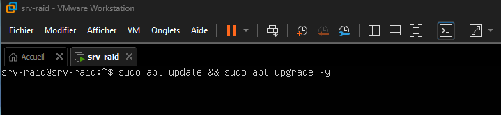
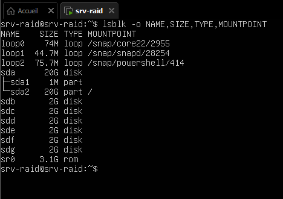
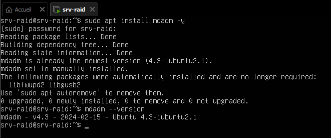
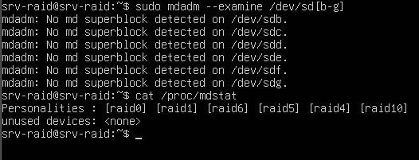
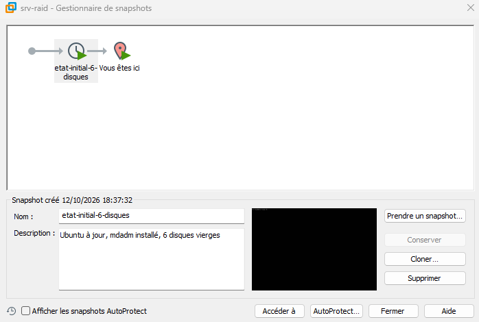

</details>

---

## 2. RAID 0, striping

**Principe.** Les données sont découpées en blocs (*chunks*) répartis à tour de rôle sur tous les disques. Les disques travaillent en parallèle, mais **aucune redondance** : si un seul disque tombe, **tout est perdu**, car chaque fichier a un morceau sur chaque disque.

| Critère | RAID 0 |
|---|---|
| Disques utilisés | 2 (`sdb`, `sdc`) |
| Capacité utile | N × taille d'un disque, soit 4 Go |
| Tolérance aux pannes | Aucune |
| Taille de chunk | 512 Ko (valeur par défaut) |

```bash
sudo mdadm --create /dev/md0 --level=0 --raid-devices=2 /dev/sdb /dev/sdc
cat /proc/mdstat
sudo mdadm --detail /dev/md0                # Raid Level : raid0, State : clean
sudo mkfs.ext4 /dev/md0
sudo mkdir -p /mnt/raid0 && sudo mount /dev/md0 /mnt/raid0
df -h /mnt/raid0                            # environ 3,8 Go utilisables
```

**Nettoyage** (à faire dans cet ordre, pour libérer les disques) :
```bash
sudo umount /mnt/raid0
sudo mdadm --stop /dev/md0
sudo mdadm --zero-superblock /dev/sdb /dev/sdc
```

**Point à retenir.** Aucune panne n'est simulée sur ce niveau : sans redondance, mdadm refuse de retirer un disque. La conclusion théorique suffit : **RAID 0 + une panne = perte totale**.

<details>
<summary>Captures de l'étape 2</summary>

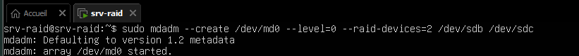
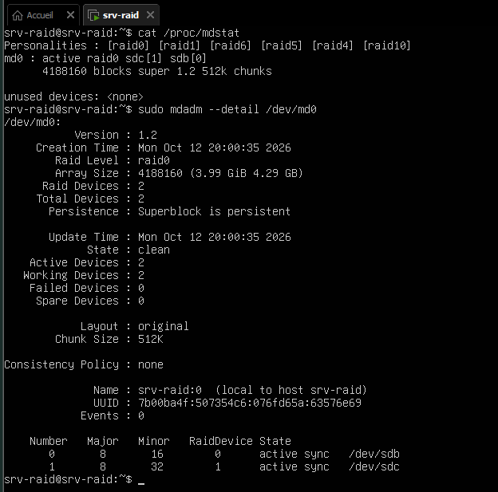
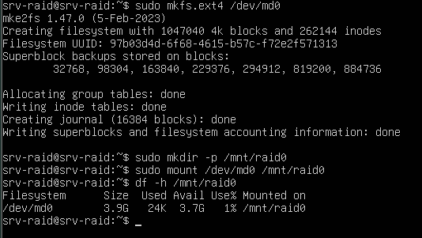
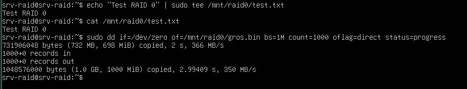
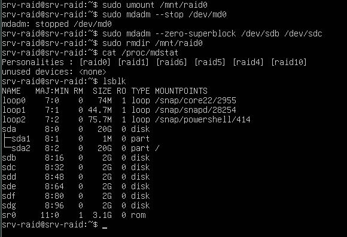

</details>

---

## 3. RAID 1, miroir

**Principe.** Chaque donnée est écrite à l'identique sur chaque disque : chaque disque est une copie exacte de l'autre. On sacrifie de la capacité pour gagner en sécurité.

| Critère | RAID 1 |
|---|---|
| Disques utilisés | 2 (`sdb`, `sdc`), `sdd` en remplacement |
| Capacité utile | 1 × taille d'un disque, soit 2 Go |
| Tolérance aux pannes | Tous les disques sauf un |

> **Un RAID n'est pas une sauvegarde.** Une suppression par erreur ou un fichier chiffré par un rançongiciel est répliqué immédiatement sur tous les disques. Le RAID protège contre la **panne matérielle d'un disque**, rien d'autre.

**Scénario réalisé :**

```bash
sudo mdadm --create /dev/md0 --level=1 --raid-devices=2 /dev/sdb /dev/sdc
watch -n1 cat /proc/mdstat                  # synchronisation initiale, puis [UU]
sudo mkfs.ext4 /dev/md0
sudo mkdir -p /mnt/raid1 && sudo mount /dev/md0 /mnt/raid1

# Données de référence et empreinte
sudo dd if=/dev/urandom of=/mnt/raid1/donnees.bin bs=1M count=100
sha256sum /mnt/raid1/donnees.bin

# Panne simulée du disque sdb
sudo mdadm /dev/md0 --fail /dev/sdb         # [U_], State : clean, degraded
sha256sum /mnt/raid1/donnees.bin            # empreinte IDENTIQUE

# Remplacement et reconstruction
sudo mdadm /dev/md0 --remove /dev/sdb
sudo mdadm /dev/md0 --add /dev/sdd          # recovery = xx%
sudo mdadm --detail /dev/md0                # clean, [UU], sdc et sdd actifs
sha256sum /mnt/raid1/donnees.bin            # empreinte toujours identique
```

**Résultat.** Le RAID passe par les états `clean`, `degraded`, puis `clean`. L'empreinte SHA-256 reste identique pendant toute la panne et la reconstruction : **aucune donnée perdue** malgré la perte d'un disque.

<details>
<summary>Captures de l'étape 3</summary>

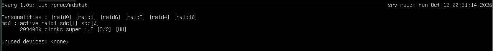
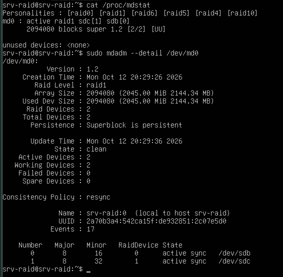
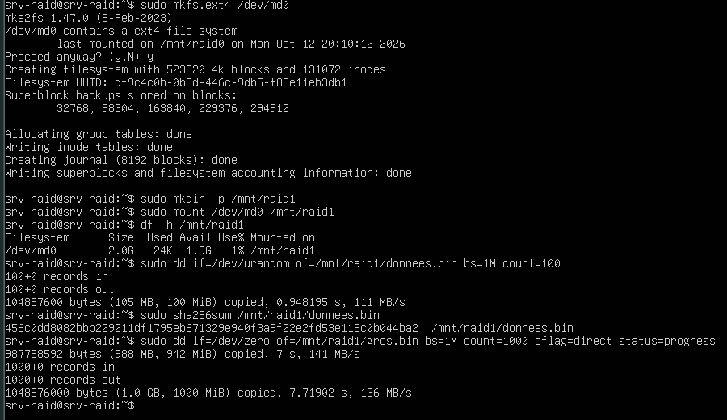
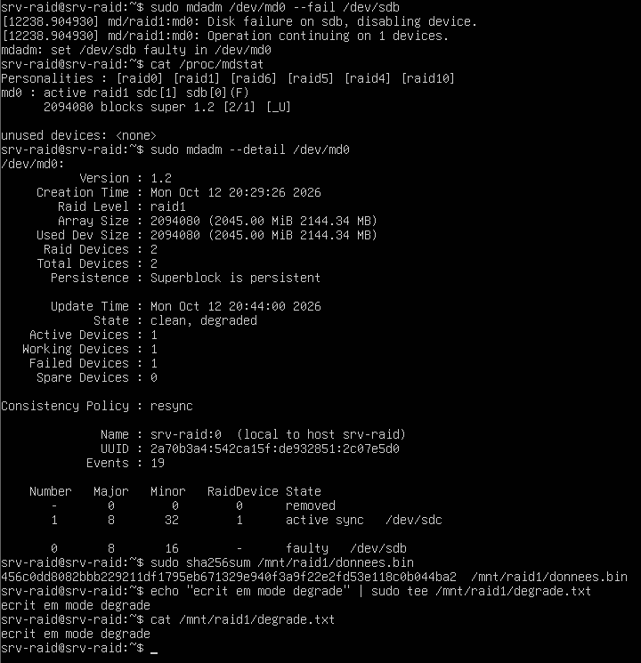
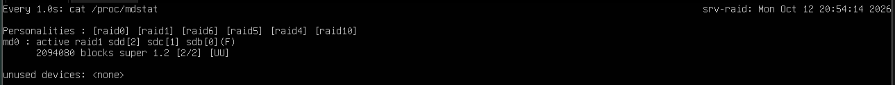
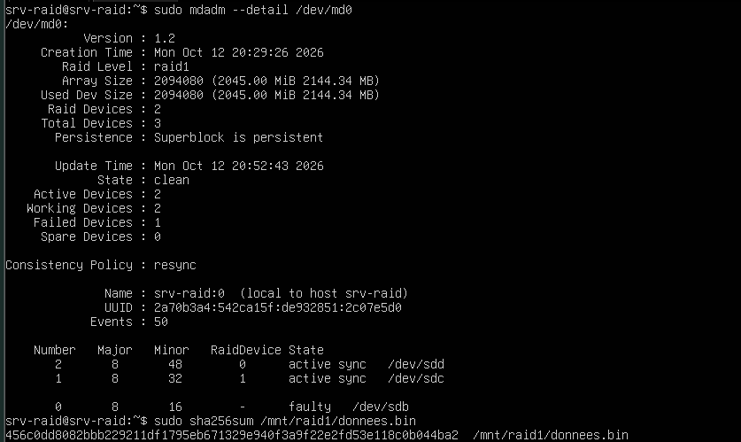
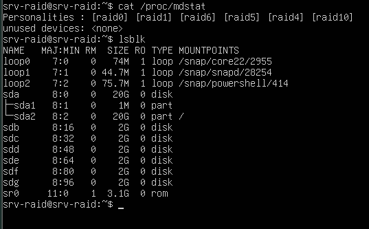

</details>

---

## 4. RAID 5, parité distribuée

**Principe.** Pour chaque tranche de données, mdadm calcule un bloc de **parité** par XOR. Si un disque est perdu, son contenu se **recalcule** à partir des autres :

```
Bloc A = 1011    Bloc B = 0110    Parité = A XOR B = 1101
Si A est perdu :  A = B XOR Parité = 0110 XOR 1101 = 1011
```

La parité **tourne** d'un disque à l'autre à chaque tranche (schéma `left-symmetric`), pour que la charge soit répartie plutôt que concentrée sur un disque dédié.

| Critère | RAID 5 |
|---|---|
| Disques utilisés | 3 (`sdb`, `sdc`, `sdd`), `sde` en remplacement |
| Capacité utile | (N − 1) × taille d'un disque, soit 4 Go |
| Tolérance aux pannes | Un seul disque |
| Écriture | Pénalisée par le calcul de la parité |

```bash
sudo mdadm --create /dev/md0 --level=5 --raid-devices=3 /dev/sdb /dev/sdc /dev/sdd
watch -n1 cat /proc/mdstat                  # "recovery" puis [UUU]
sudo mdadm --detail /dev/md0                # Layout : left-symmetric, Chunk Size : 512K
```

> Au démarrage, `/proc/mdstat` affiche `recovery` et non `resync` : pour accélérer la création, mdadm monte le RAID 5 avec deux disques actifs et **calcule la parité sur le troisième**. L'effet final est identique.

La panne de `sdb`, son remplacement par `sde` et la vérification par empreinte SHA-256 suivent le même scénario qu'au RAID 1 : `[_UU]` pendant la panne, données lues **par recalcul à la volée** (donc plus lentement), puis reconstruction par recalcul XOR sur le nouveau disque.

**Limite structurelle.** Pendant la reconstruction, le RAID n'a **plus aucune marge** : un second disque défaillant à ce moment-là entraîne la perte totale. Sur de gros disques, la reconstruction dure longtemps, ce qui augmente ce risque. C'est la motivation du RAID 6.

<details>
<summary>Captures de l'étape 4</summary>

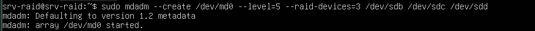
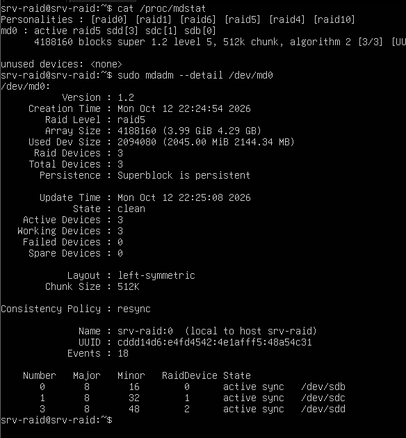
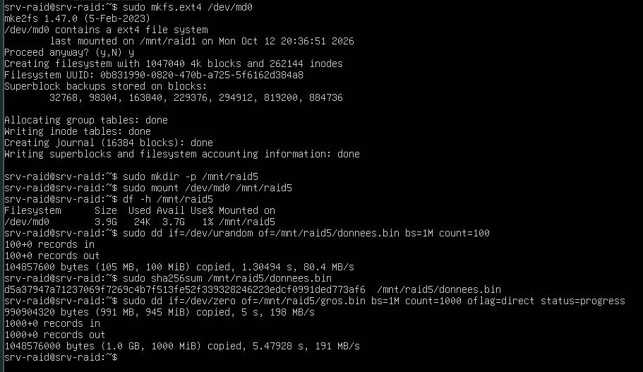
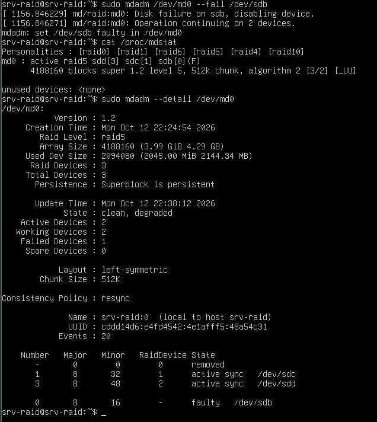
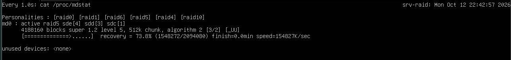
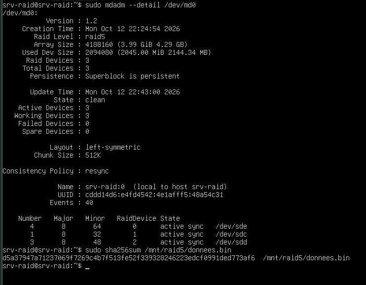
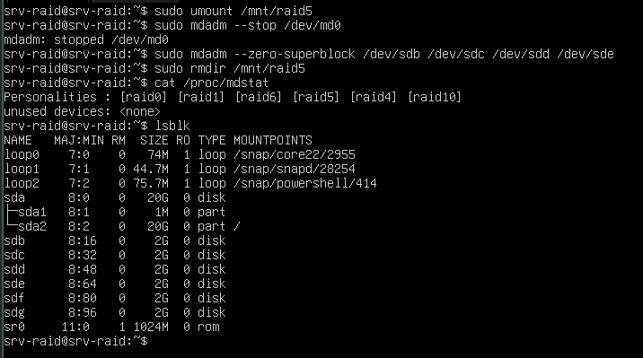

</details>

---

## 5. RAID 6, double parité

**Principe.** Deux blocs de parité **indépendants**, **P** et **Q**, par tranche. Avec une parité (RAID 5), on a une équation : elle permet de retrouver une inconnue. Avec deux parités, on a deux équations : elles permettent de retrouver **deux** disques perdus. **P** est un XOR simple, **Q** est calculée par une autre méthode (calcul dans un corps de Galois, de type Reed-Solomon), ce qui rend les deux informations réellement distinctes.

| Critère | RAID 6 |
|---|---|
| Disques utilisés | 4 (`sdb` à `sde`), `sdf` et `sdg` en remplacement |
| Capacité utile | (N − 2) × taille d'un disque, soit 4 Go |
| Tolérance aux pannes | **Deux disques quelconques** |
| Écriture | Plus pénalisée qu'en RAID 5 (deux parités) |

**Scénario réalisé : double panne.**

```bash
sudo mdadm --create /dev/md0 --level=6 --raid-devices=4 /dev/sdb /dev/sdc /dev/sdd /dev/sde
watch -n1 cat /proc/mdstat                  # resync, puis [UUUU]

sudo mdadm /dev/md0 --fail /dev/sdb         # [_UUU] : il reste une parité de marge
sudo mdadm /dev/md0 --fail /dev/sdc         # [__UU] : plus aucune redondance
sha256sum /mnt/raid6/donnees.bin            # empreinte IDENTIQUE avec deux disques en moins
echo "écrit avec 2 disques en panne" | sudo tee /mnt/raid6/degrade.txt

sudo mdadm /dev/md0 --remove /dev/sdb /dev/sdc
sudo mdadm /dev/md0 --add /dev/sdf /dev/sdg # reconstruction des deux disques
```

**Résultat.** Avec **deux disques sur quatre** en panne, les données restent lisibles (empreinte identique) et le RAID reste utilisable en écriture. Après remplacement, le RAID revient à `clean` avec `[UUUU]`. C'est la différence concrète entre RAID 5 et RAID 6 : la même double panne aurait été fatale au RAID 5.

> La capture de la double panne tient sur **deux images** : `28-raid6-double-panne-a.png` et `28-raid6-double-panne-b.png`.

<details>
<summary>Captures de l'étape 5</summary>

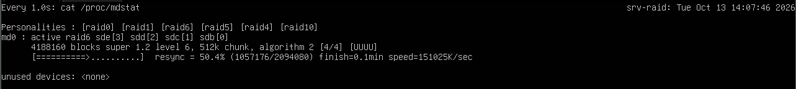
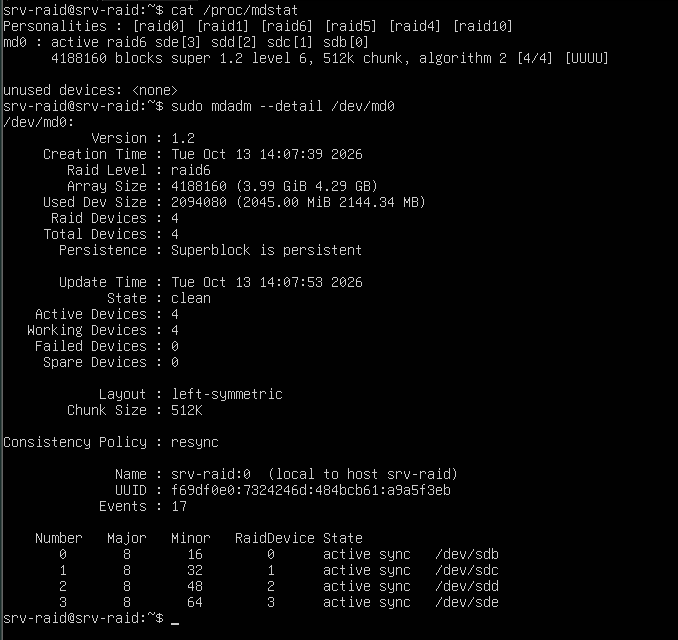
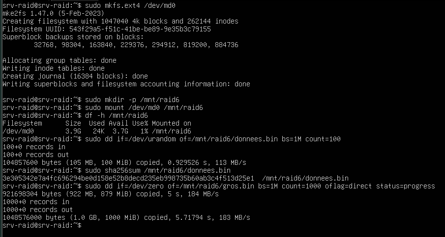
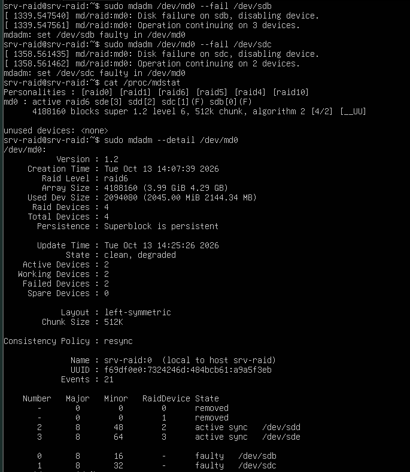
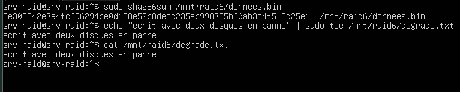
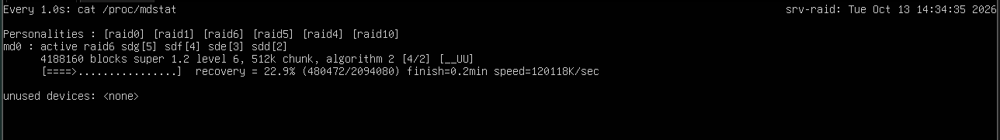
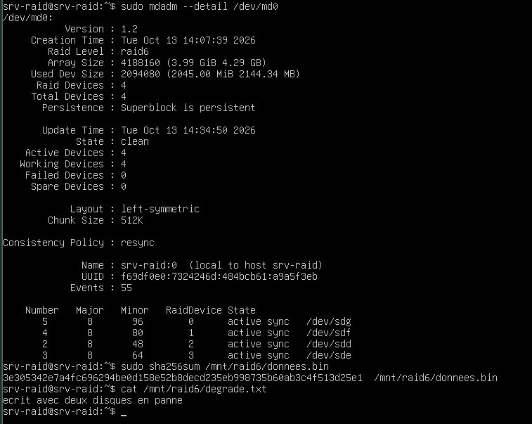
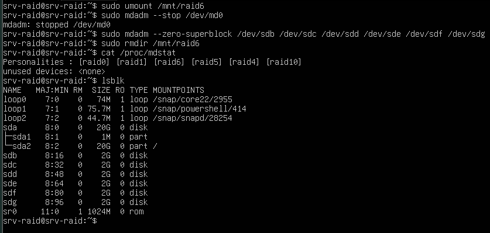

</details>

---

## 6. RAID 10, miroirs et striping

**Principe.** On forme des **paires en miroir** (RAID 1), puis on répartit les données sur ces paires (RAID 0). Aucune parité : on copie simplement, ce qui rend le RAID 10 **rapide en écriture** et **rapide à reconstruire** (reconstruire un disque, c'est recopier son partenaire).

```
              Fichier : [A][B][C][D]
                    │ striping (RAID 0)
        ┌───────────┴───────────┐
   Paire 1 (miroir)        Paire 2 (miroir)
 sdb [A][C]  sdc [A][C]  sdd [B][D]  sde [B][D]
```

mdadm propose un niveau `--level=10` natif, avec le schéma par défaut `near=2` : deux copies de chaque bloc sur des disques voisins. L'**ordre des disques** donné à la création détermine donc les paires : avec `sdb sdc sdd sde`, ce sont (`sdb`, `sdc`) et (`sdd`, `sde`), repérables dans la colonne `RaidDevice` de `mdadm --detail` (paires 0-1 et 2-3).

| Critère | RAID 10 |
|---|---|
| Disques utilisés | 4 (`sdb` à `sde`), `sdf` et `sdg` en remplacement |
| Capacité utile | N / 2 × taille d'un disque, soit 4 Go |
| Tolérance aux pannes | **Conditionnelle** : dépend de quels disques tombent |
| Reconstruction | Simple copie, rapide |

**La tolérance dépend des paires :**

| Disques en panne | Résultat attendu |
|---|---|
| `sdb` + `sdd` (une par paire) | Données intactes : chaque paire garde un exemplaire |
| `sdb` + `sdc` (les deux de la paire 1) | Données perdues : les blocs de cette paire n'existent plus |

> Ne pas confondre **RAID 10** (miroirs puis striping) et **RAID 0+1** (striping puis miroir), ce dernier étant moins résistant.

**Scénario réalisé : double panne de paires différentes.**

```bash
sudo mdadm --create /dev/md0 --level=10 --raid-devices=4 /dev/sdb /dev/sdc /dev/sdd /dev/sde
sudo mdadm /dev/md0 --fail /dev/sdb
sudo mdadm /dev/md0 --fail /dev/sdd         # [_U_U], State : clean, degraded
sha256sum /mnt/raid10/donnees.bin           # empreinte IDENTIQUE, sans aucun calcul de parité

sudo mdadm /dev/md0 --remove /dev/sdb /dev/sdd
sudo mdadm /dev/md0 --add /dev/sdf /dev/sdg # copie depuis le partenaire de chaque paire
```

**Résultat.** Les deux pannes sont tolérées parce qu'elles touchent deux paires différentes. Mdadm lit simplement la copie restante, sans recalcul : la reconstruction est une copie, donc plus rapide qu'en RAID 5 ou 6.

### Le pire cas : deux disques de la même paire

On a tenté de déclarer en panne **les deux disques d'une même paire** (identifiés par la colonne `RaidDevice`, valeurs 0 et 1).

**Observation : le système ne l'a pas permis.** Mdadm a refusé de retirer le second disque, avec le message :

```
mdadm: Cannot remove /dev/sdc from /dev/md0, array will be failed
```

Autrement dit, mdadm **protège de lui-même la dernière copie** d'une paire : l'opération aurait fait passer le RAID en état *failed*, et il l'a empêchée. C'est l'un des deux comportements qu'on pouvait anticiper (refus du noyau, ou RAID inactif).

**À retenir.** Ce refus protège uniquement contre une opération **volontaire**. Il ne protège pas contre une **vraie panne simultanée** de deux disques d'une même paire : dans ce cas, les données de la paire seraient perdues. C'est la limite structurelle du RAID 10 face au RAID 6, qui survit à **n'importe quelles** deux pannes. D'où l'importance de la surveillance et du remplacement rapide (étape 8).

> La capture de la double panne tient sur **deux images** : `35-raid10-double-panne-a.png` et `35-raid10-double-panne-b.png`.

<details>
<summary>Captures de l'étape 6</summary>

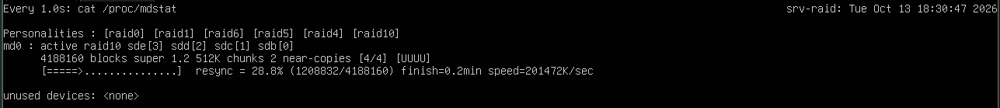
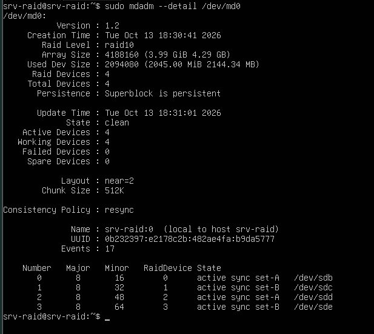
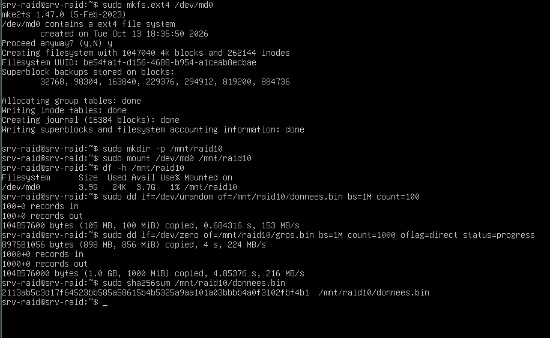
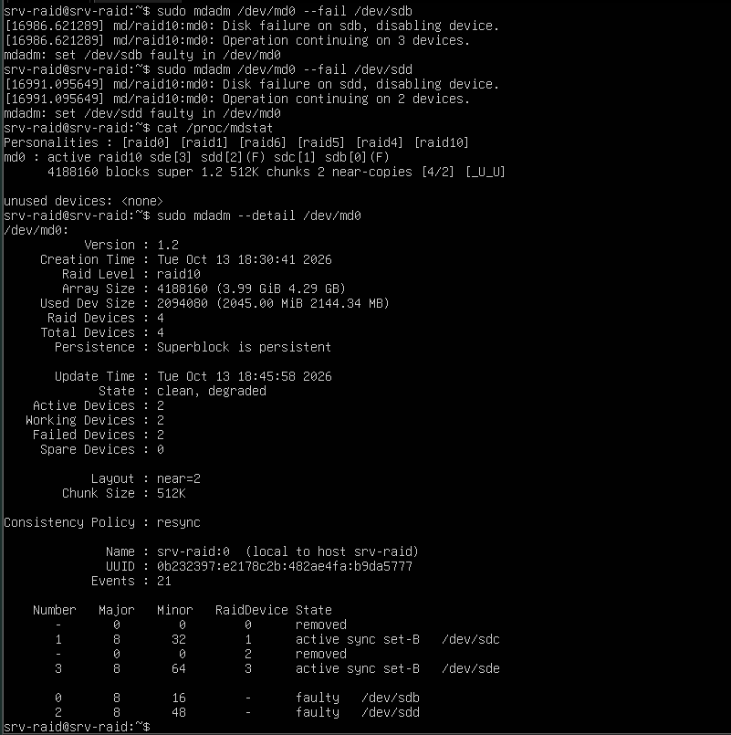
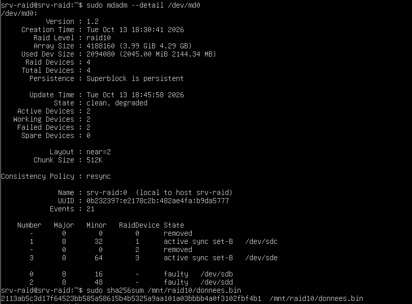
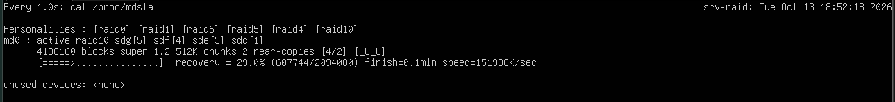
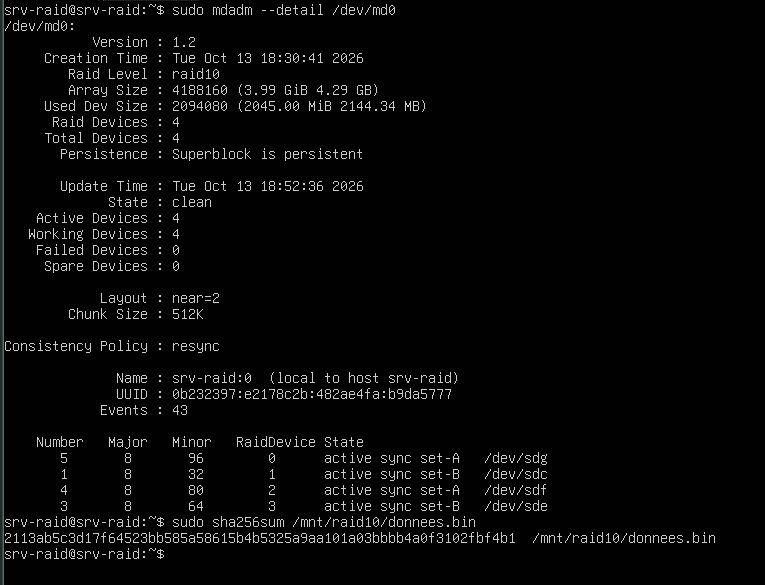
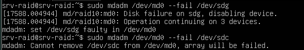
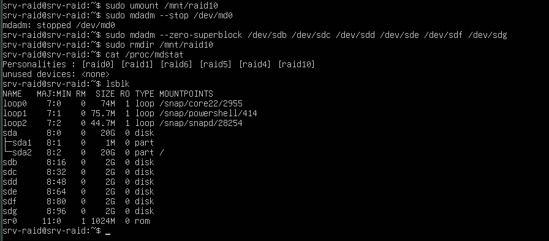

</details>

---

## 7. Persistance

**Problème.** Jusqu'ici, les RAID n'ont existé que dans la session en cours. Après un redémarrage, le RAID peut ne pas être réassemblé, prendre un nom inattendu (`/dev/md127`) ou ne pas être monté.

| Élément | Rôle |
|---|---|
| Superblock (sur chaque disque) | Identité du RAID. Le noyau peut réassembler seul, mais avec un nom automatique |
| `/etc/mdadm/mdadm.conf` | Fixe le nom (`/dev/md0`) et l'UUID du **RAID** |
| `update-initramfs -u` | Copie cette configuration dans l'image chargée très tôt au démarrage |
| `/etc/fstab` | Dit où monter le **système de fichiers**, identifié par son propre UUID |

> **Deux UUID différents** : celui du **RAID** (dans `mdadm.conf`) et celui du **système de fichiers** ext4 (dans `fstab`). Les confondre est l'erreur la plus fréquente.

Le test a été réalisé sur un **RAID 5 de 3 disques** (`sdb`, `sdc`, `sdd`) monté sur `/mnt/raid5`.

```bash
# 1. Enregistrer le RAID dans mdadm.conf (une seule fois, sinon doublon)
sudo mdadm --detail --scan | sudo tee -a /etc/mdadm/mdadm.conf
sudo update-initramfs -u

# 2. Préparer fstab, avec sauvegarde, UUID du système de fichiers et nofail
sudo cp /etc/fstab /etc/fstab.bak
sudo blkid /dev/md0
# ligne ajoutée :
# UUID=<uuid-du-systeme-de-fichiers>  /mnt/raid5  ext4  defaults,nofail  0  2

# 3. Tester SANS redémarrer
sudo umount /mnt/raid5
sudo mount -a
findmnt /mnt/raid5

# 4. Redémarrer, puis vérifier
sudo reboot
cat /proc/mdstat
df -h /mnt/raid5
sha256sum /mnt/raid5/donnees.bin
```

**Les précautions sur `fstab`.** Une erreur dans ce fichier peut empêcher le démarrage normal. Trois protections : une **sauvegarde** avant modification, l'option **`nofail`** (le démarrage continue si le RAID est absent au lieu de bloquer en mode d'urgence) et le **test `mount -a`** avant de redémarrer. Un snapshot VMware a aussi été pris avant le redémarrage.

**Résultat.** Après redémarrage, le RAID est actif sans intervention (`[UUU]`, `clean`), porte bien le nom `/dev/md0`, `/mnt/raid5` est monté automatiquement et l'empreinte du fichier de référence est identique à celle d'avant le redémarrage.

Les fichiers de configuration utiles sont conservés dans [`configs/`](configs/) : [`mdadm.conf`](configs/mdadm.conf) et [`fstab-raid5.txt`](configs/fstab-raid5.txt), ce dernier ne contenant que la ligne du RAID, pas le `fstab` complet du système.

<details>
<summary>Captures de l'étape 7</summary>

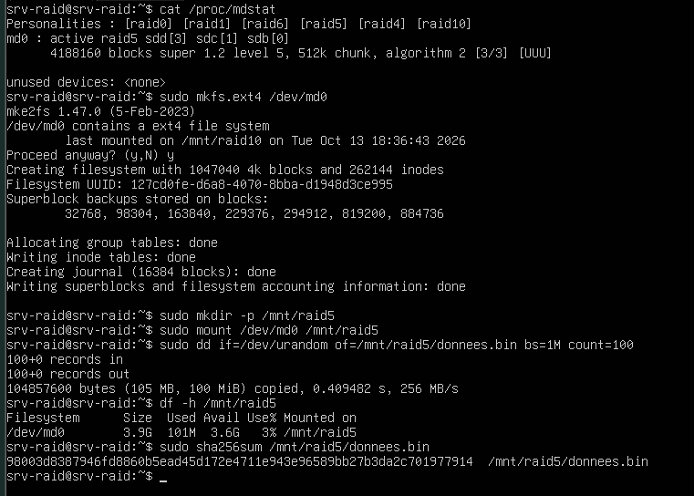
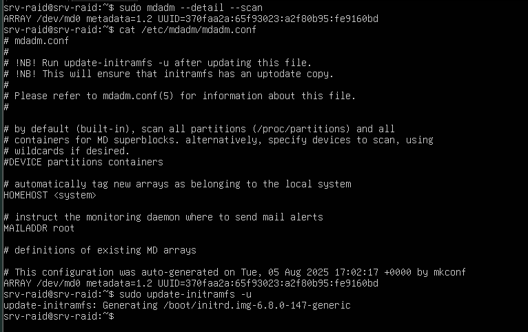
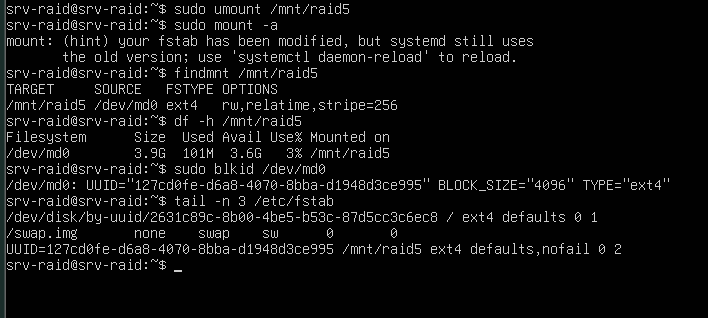


</details>

---

## 8. Surveillance et alertes

**Problème.** Un RAID est fait pour continuer à fonctionner quand un disque tombe, ce qui est aussi son piège : si personne n'est prévenu, le serveur tourne sans protection, parfois pendant des semaines, jusqu'à la deuxième panne. **Un RAID sans surveillance donne une fausse impression de sécurité.**

**Le mécanisme.** `mdadm --monitor` est un démon qui observe les RAID et déclenche des **événements** : `Fail`, `FailSpare`, `DegradedArray`, `RebuildStarted`, `Rebuild20/40/60/80`, `RebuildFinished`, `SpareActive`, `DeviceDisappeared`, `TestMessage`. À chaque événement, il peut envoyer un mail (`MAILADDR`) ou lancer un programme (`PROGRAM`). Sur Ubuntu, le service **`mdmonitor`** le lance déjà au démarrage.

**Choix du laboratoire.** Les alertes par mail demandent un serveur de messagerie, ce qui sort du cadre du projet. On utilise donc un **script** appelé par mdadm. Il écrit chaque alerte dans un fichier de log dédié (`/var/log/raid-alerts.log`) et dans le journal système (`journalctl -t raid-alert`). Le principe est identique à un mail : seul le canal change, et le script peut être adapté pour envoyer un mail ou appeler un webhook.

Script : [`scripts/raid-alert.sh`](scripts/raid-alert.sh), installé sur le serveur dans `/usr/local/sbin/`.

```bash
# Test du chemin complet, sans rien casser : événement TestMessage
sudo mdadm --monitor --scan --oneshot --test --program=/usr/local/sbin/raid-alert.sh
cat /var/log/raid-alerts.log

# Rendre la configuration permanente (une seule fois)
echo 'PROGRAM /usr/local/sbin/raid-alert.sh' | sudo tee -a /etc/mdadm/mdadm.conf
sudo systemctl restart mdmonitor

# Panne réelle observée par le démon
sudo mdadm /dev/md0 --fail /dev/sdb
cat /var/log/raid-alerts.log                # alertes Fail et DegradedArray
sudo mdadm /dev/md0 --remove /dev/sdb
sudo mdadm /dev/md0 --add /dev/sde          # suivi de la reconstruction
```

**Détecter la corruption silencieuse : le scrub.** La surveillance détecte les **pannes** de disque, pas un bloc devenu illisible sans que le disque soit déclaré en panne. Pour cela, mdadm sait relire tout le RAID et vérifier la cohérence des parités :

```bash
echo check | sudo tee /sys/block/md0/md/sync_action
cat /sys/block/md0/md/mismatch_cnt          # doit valoir 0 sur un RAID sain
systemctl list-timers --all | grep -i mdcheck
```

Sur Ubuntu, un minuteur systemd (`mdcheck_start.timer`) lance ce contrôle automatiquement une fois par mois.

<details>
<summary>Captures de l'étape 8</summary>

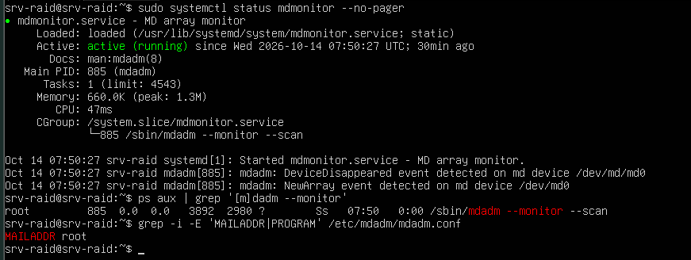
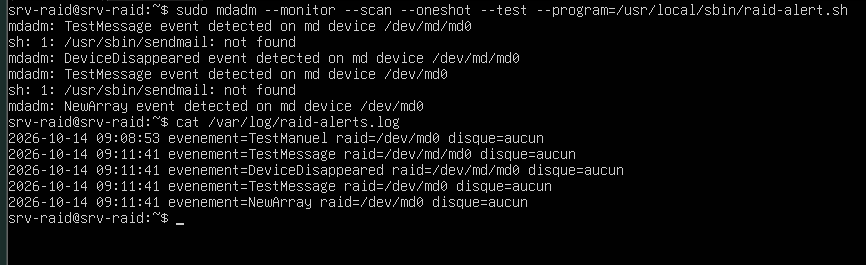
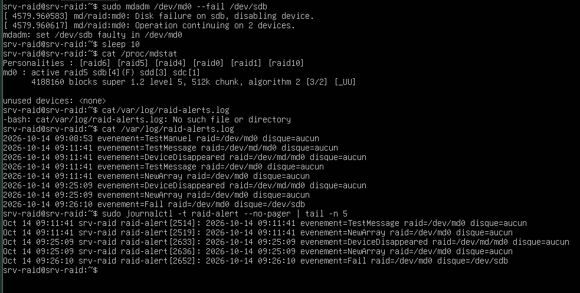
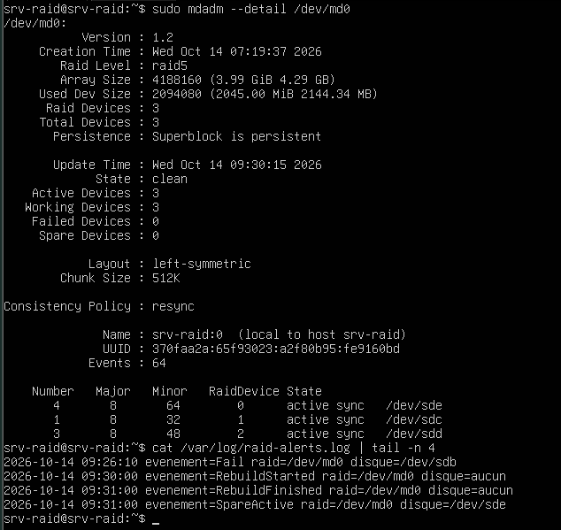
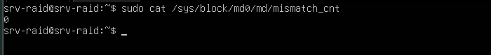

</details>

---

## 9. Comparaison des niveaux

### 9.1 Comparaison théorique

Capacités calculées avec des disques de 2 Go.

| Niveau | Disques min. | Capacité utile | Capacité (4 disques) | Pannes tolérées | Écriture | Reconstruction |
|---|---|---|---|---|---|---|
| RAID 0 | 2 | N × taille | 8 Go | 0 | Très rapide | Impossible |
| RAID 1 | 2 | 1 × taille | 2 Go (2 disques) | N − 1 | Comme un disque | Copie simple |
| RAID 5 | 3 | (N − 1) × taille | 6 Go | 1 | Pénalisée (parité) | Recalcul, lente |
| RAID 6 | 4 | (N − 2) × taille | 4 Go | 2 quelconques | Plus pénalisée (double parité) | Recalcul, lente |
| RAID 10 | 4 | N / 2 × taille | 4 Go | 1 à N/2, selon les paires | Bonne | Copie, rapide |

**Rendement** (capacité utile sur capacité brute) avec 4 disques : RAID 0 = 100 %, RAID 5 = 75 %, RAID 6 et RAID 10 = 50 %, RAID 1 (2 disques) = 50 %.

### 9.2 Protocole de mesure

Pour que la comparaison soit équitable :

1. **4 disques** pour RAID 0, 5, 6 et 10 ; **2 disques** pour le RAID 1.
2. Une **référence** : un **disque seul** (`sdb` formaté en ext4, sans RAID).
3. Même système de fichiers (ext4) et mêmes commandes `fio` pour toutes les configurations.
4. **Attente de la fin de la synchronisation** (`mdadm --wait`) avant chaque mesure, sinon la construction du RAID en arrière-plan fausse les résultats.
5. Un seul niveau à la fois, avec nettoyage complet entre deux (`--zero-superblock`, `wipefs -a`).
6. **Deux passages complets** sur les six configurations.

Quatre tests `fio`, lancés par [`scripts/bench-raid.sh`](scripts/bench-raid.sh) :

| Test | Paramètres | Ce que ça simule |
|---|---|---|
| Écriture séquentielle | blocs de 1 Mo | Copie de gros fichier, sauvegarde |
| Lecture séquentielle | blocs de 1 Mo | Lecture de gros fichier, streaming |
| Lecture aléatoire | blocs de 4 Ko | Base de données, nombreux petits fichiers |
| Écriture aléatoire | blocs de 4 Ko | Base de données en écriture, journaux |

Paramètres communs : `--direct=1` (contourne le cache mémoire de la VM), `--ioengine=libaio`, `--iodepth=16`, fichier de 512 Mo, 15 secondes par test. Les résultats sont enregistrés dans [`docs/resultats.csv`](docs/resultats.csv).

### 9.3 Résultats

Valeurs **passage 1 / passage 2**. Débits en Mio/s pour les tests séquentiels, en IOPS pour les tests aléatoires.

| Test | Disque seul | RAID 0 | RAID 1 | RAID 5 | RAID 6 | RAID 10 |
|---|---|---|---|---|---|---|
| Écriture séquentielle (Mio/s) | 1451 / 916 | 758 / 748 | 165 / 132 | 126 / 191 | 83 / 112 | 133 / 139 |
| Lecture séquentielle (Mio/s) | 1204 / 950 | 898 / 850 | 1206 / 941 | 594 / 1024 | 840 / 968 | 893 / 812 |
| Lecture aléatoire (IOPS) | 10305 / 12061 | 6769 / 11786 | 6725 / 11659 | 7198 / 11450 | 6880 / 11632 | 6501 / 11303 |
| Écriture aléatoire (IOPS) | 5858 / 5932 | 5627 / 5583 | 3530 / 3210 | 1740 / 2242 | 2077 / 2581 | 3374 / 3192 |

**Notes sur les données :**
- Les lignes du second passage portent le suffixe `-p2` dans le CSV. Pour RAID 5 et RAID 6, ce suffixe a été ajouté **à la main** après coup (le script produisait des libellés identiques aux deux passages) ; les valeurs n'ont pas été modifiées.
- Une faute de frappe a été détectée puis corrigée dans le fichier avant publication : la ligne `raid0,ecriture-seq` du passage 1 portait `777.7` au lieu de la valeur réellement mesurée `757.7`. L'incohérence était visible car, avec des blocs de 1 Mo, le débit en Mio/s doit être à peu près égal au nombre d'IOPS (`757.7` pour `758`).

### 9.4 Analyse

#### Ce qui est solide : reproduit dans les deux passages

**1. L'écriture aléatoire est le test le plus stable, et il dessine trois paliers nets** dont les plages ne se chevauchent pas :

| Palier | Configurations | IOPS (deux passages) | Explication |
|---|---|---|---|
| Aucune pénalité | Disque seul, RAID 0 | 5583 à 5932 | Une écriture demandée = une écriture réalisée |
| Duplication | RAID 1, RAID 10 | 3192 à 3530 | Chaque écriture est faite en deux exemplaires |
| Parité | RAID 5, RAID 6 | 1740 à 2581 | Lire l'ancien bloc et l'ancienne parité, recalculer, réécrire |

**2. En écriture séquentielle, le RAID 0 est très au-dessus des RAID redondants** : 748 à 758 Mio/s, contre 83 à 191 Mio/s pour RAID 1, 5, 6 et 10. Le RAID 6 est le plus lent dans les deux passages, ce qui concorde avec le coût de la double parité.

**3. RAID 5 et RAID 6 ne se distinguent pas en écriture aléatoire.** Le RAID 6 est devant dans les deux passages, mais les plages se chevauchent (RAID 5 : 1740 à 2242, RAID 6 : 2077 à 2581) et l'écart est plus petit que la variation de chaque niveau d'un passage à l'autre. Aucune conclusion n'est tirée.

#### Ce qui n'est pas fiable : à ne pas utiliser pour classer les niveaux

- **Lecture aléatoire et lecture séquentielle** : au passage 2, toutes les configurations sont à moins de 6 % l'une de l'autre en lecture aléatoire (11303 à 12061 IOPS) et à environ ±15 % en lecture séquentielle (812 à 1024 Mio/s). Au passage 1, les RAID semblaient nettement plus lents en lecture aléatoire, mais **tout le lot a basculé en même temps** d'un passage à l'autre (+60 à +75 %) : l'écart ne vient donc pas des niveaux RAID. La lecture ne permet pas de les distinguer avec ce protocole.
- **La lecture séquentielle de 594 Mio/s du RAID 5 au passage 1** était une valeur aberrante, confirmée par le passage 2 (1024 Mio/s).
- **Le classement entre RAID redondants en écriture séquentielle change d'un passage à l'autre** (RAID 1 > RAID 10 > RAID 5 > RAID 6 au passage 1, RAID 5 > RAID 10 > RAID 1 > RAID 6 au passage 2). Seul le RAID 6 en dernière position tient.
- **Le disque seul est instable en séquentiel** (1451 puis 916 Mio/s en écriture). Les pourcentages « par rapport au disque seul » n'ont de sens qu'à l'intérieur d'un même passage : le RAID 0 vaut 52 % du disque seul au passage 1, 82 % au passage 2.

#### La variabilité entre deux passages

La même configuration varie de **15 % à plus de 70 %** d'un passage à l'autre (par exemple RAID 5 en lecture séquentielle, ou la lecture aléatoire de tous les RAID). Des écarts de 10 à 30 % entre deux configurations mesurées à des moments différents n'ont donc **aucune valeur**. La cause la plus probable est l'état de la machine hôte (cache, charge, support de stockage), mais elle n'a pas été isolée.

#### Pourquoi aucun RAID ne bat le disque seul ici

Les six disques virtuels reposent sur **le même support physique** de la machine hôte. Le parallélisme, qui est la source du gain en conditions réelles (le RAID 0 accélère parce que plusieurs disques physiques travaillent en même temps), n'existe donc pas. Il reste le coût de la couche logicielle mdadm. **En laboratoire virtualisé, on mesure le coût de chaque niveau, pas son gain.** Ces chiffres servent à comparer les niveaux entre eux, pas à prédire des performances sur du matériel réel.

<details>
<summary>Captures de l'étape 9</summary>

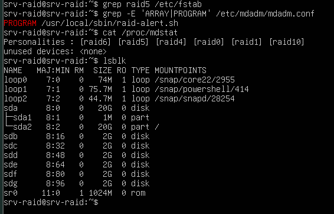


</details>

---

## 10. Conclusion

### Quel niveau pour quel besoin

| Besoin | Niveau adapté | Raison |
|---|---|---|
| Vitesse maximale, données jetables ou répliquées ailleurs | RAID 0 | Aucune pénalité d'écriture, mais aucune tolérance aux pannes |
| Petit serveur, 2 disques, sécurité simple | RAID 1 | Lecture intacte, reconstruction par simple copie, mais capacité réduite de moitié |
| Meilleur rendement capacité/sécurité, charge surtout en lecture | RAID 5 | 75 % de capacité avec 4 disques, mais écritures aléatoires pénalisées |
| Données importantes, gros disques, deux pannes tolérées | RAID 6 | Survit à deux pannes quelconques, au prix des écritures les plus lentes |
| Base de données, charge d'écriture élevée, reconstruction rapide | RAID 10 | Écritures peu pénalisées, reconstruction rapide, mais tolérance dépendante des paires |

### Ce que ce laboratoire a montré

1. **Chaque niveau tient sa promesse sur les données.** Pour RAID 1, 5, 6 et 10, l'empreinte SHA-256 est restée identique pendant les pannes simulées et après la reconstruction.
2. **La tolérance aux pannes n'est pas un nombre, c'est une condition.** RAID 5 : un disque. RAID 6 : deux disques quelconques. RAID 10 : deux disques seulement s'ils sont dans des paires différentes. Au pire cas, mdadm a lui-même refusé l'opération qui aurait détruit le RAID.
3. **Le coût de la redondance se paie à l'écriture**, en trois paliers : aucune pénalité, duplication, parité. En lecture, les niveaux ne se distinguent pas avec ce protocole.
4. **Un RAID n'est pas une sauvegarde.** Il protège contre la panne d'un disque, pas contre une suppression, une corruption logicielle ou un rançongiciel.
5. **Un RAID sans surveillance n'est pas sûr.** C'est l'alerte et le remplacement rapide qui transforment la tolérance aux pannes en protection réelle.
6. **Une mesure isolée n'est pas un résultat.** Un second passage a renversé une conclusion qui paraissait solide après un seul.

---

## Limites et pistes d'amélioration

**Limites du laboratoire :**
- Les disques virtuels partagent un même support physique : pas de gain de parallélisme, mesures non transposables telles quelles à du matériel réel.
- Les pannes sont **simulées logiquement** (`mdadm --fail`). Une vraie panne matérielle se comporterait différemment : mdadm détecterait lui-même le disque défaillant et générerait les alertes sans intervention.
- Deux passages de mesure ne suffisent pas à estimer une variabilité de manière statistique.
- Aucun disque de rechange (*hot spare*) n'est configuré : le remplacement est manuel.

**Pistes d'amélioration :**
- Retirer réellement un disque virtuel dans VMware pendant que le RAID tourne, pour observer la détection automatique et les alertes.
- Configurer un **disque de rechange** pour que la reconstruction démarre automatiquement.
- Remplacer l'alerte par fichier de log par une **alerte réelle** (mail via un relais SMTP ou webhook).
- Répéter les mesures **trois à cinq fois** par configuration et retenir la médiane, dans un ordre de passage aléatoire.
- Mesurer sur des disques **physiques** distincts pour observer le vrai gain du RAID 0 et du RAID 10.
- Ajouter **LVM** par-dessus le RAID, ou comparer avec les systèmes de fichiers à parité intégrée (ZFS, Btrfs).

## Compétences mises en œuvre

- Administration de RAID logiciel Linux avec `mdadm` : création, supervision, simulation de panne, remplacement de disque, reconstruction.
- Configuration de la persistance au démarrage : `mdadm.conf`, `initramfs`, `fstab` (UUID, `nofail`).
- Supervision : démon `mdadm --monitor`, script d'alerte en bash, journalisation, vérification d'intégrité (scrub).
- Mesure de performances avec `fio` : conception d'un protocole équitable, analyse critique de la variabilité des résultats.
- Rigueur de méthode : vérification d'intégrité par empreinte SHA-256, correction d'une donnée erronée avant publication, séparation entre résultats solides et résultats non fiables.
- Gestion de version avec Git et GitHub : un commit poussé à chaque étape.
